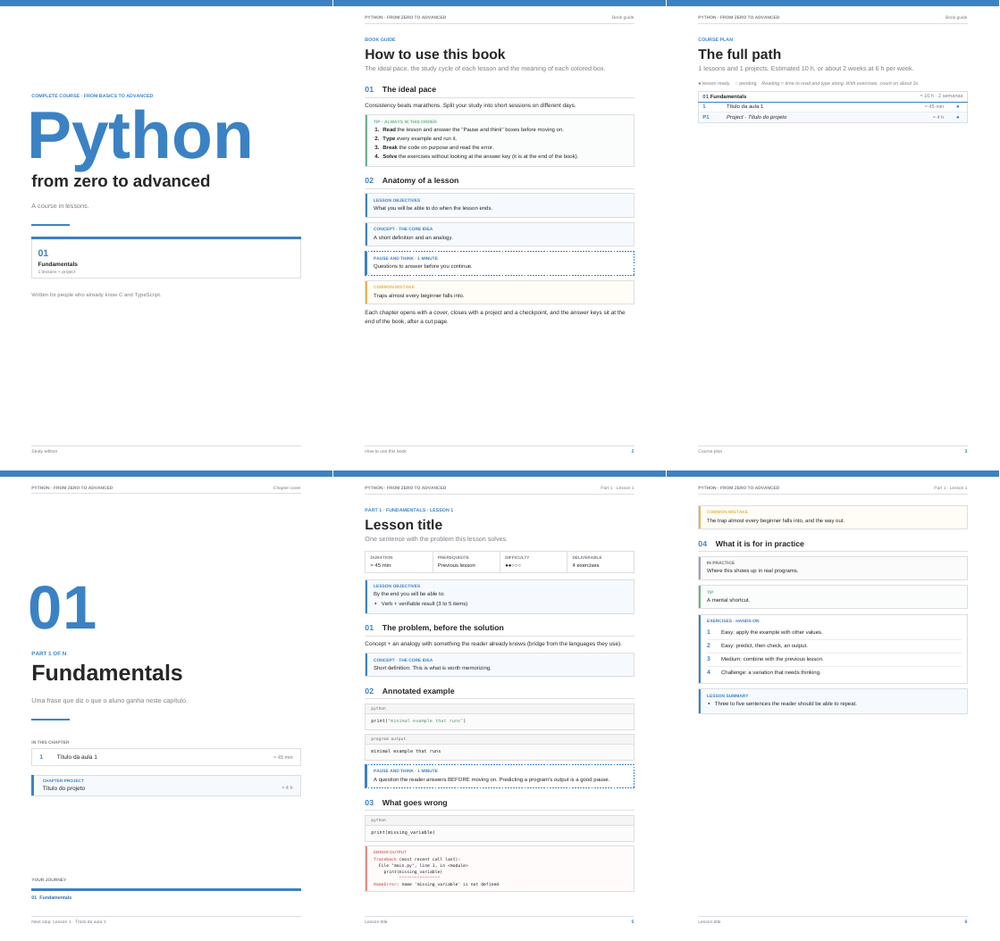

# book-forge

Uma skill do [Claude Code](https://docs.claude.com/en/docs/claude-code/overview) que planeja e escreve
um livro ou curso técnico em **PDF**, aula por aula, com um design fixo e código **verificado de verdade**.
Nasceu do livro "Rust do Zero ao Avançado" (25 peças, 469 páginas).



## O que ela faz
- Entrevista (tema, público, **idioma pt-BR ou inglês**, escala, **cor do tema**, abordagem) e plano de
  conteúdo com mapa de conceitos.
- Motor de PDF pronto (`build.py` + fontes): capas de capítulo, caixas coloridas, gabaritos, referências.
  Temas: orange (original), blue, green, purple, teal, red.
- Código executado de verdade: `verify_code.py` roda python, js, ts, c, cpp, go, sh e rust simples e
  **captura** erros e saídas para o livro (nunca digitados à mão). `lint_book.py` confere a estrutura.
- Modo opcional com **um sub-agente por capítulo** (a skill pergunta e avisa que gasta bem mais tokens).
- `PROGRESS.md` como memória entre sessões.

## Instalar
```sh
git clone https://github.com/JotaPeans/book-forge ~/.claude/skills/book-forge
pip install reportlab
```
Depois, no Claude Code: peça "quero criar um livro sobre X em PDF".

## Estrutura
- `SKILL.md`: o fluxo que o Claude segue.
- `references/`: planejamento, design, escrita de aulas, verificação, sub-agentes.
- `assets/engine/`: motor (build, ferramentas, fontes). `assets/scaffold/`: modelos.
- `scripts/scaffold.py`: cria a pasta de um livro novo.

Licença: MIT (código e textos). Fontes: veja `THIRD_PARTY.md`.
